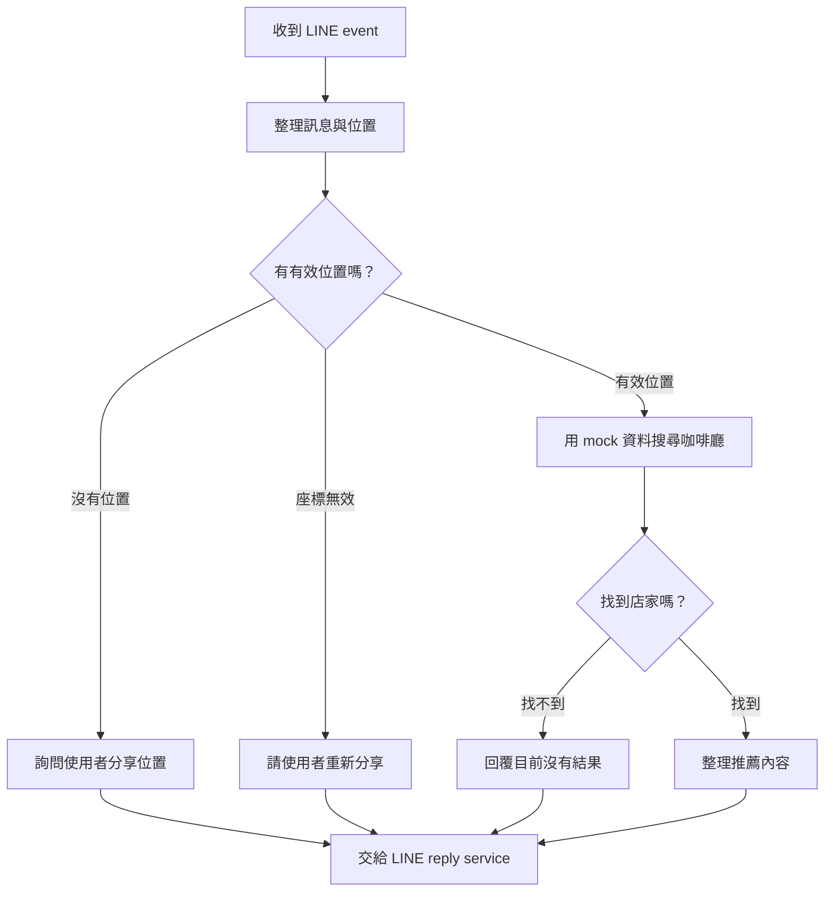

# 第 1 天：Google ADK 的 Graph Workflow 是什麼？（60–75 分鐘）

今天不是只背 node、edge、route 三個單字。我們會先看 LINE Cafe Bot 現在怎麼處理一則訊息，再畫出如果交給 ADK Graph Workflow，流程會長什麼樣。完成後，你應該能用自己的話解釋一筆訊息如何從 LINE 走到回覆。

## 學習目標

完成今天後，你可以：

1. 說明 node、edge、route 和 workflow 的差異。
2. 從現有程式找出 LINE event 的處理路徑。
3. 畫出「有位置、缺位置、搜尋無結果」三條基本流程。
4. 分辨哪些步驟是一般程式，哪些步驟才可能需要 LLM。

## 先用生活例子理解 Graph

把 workflow 想成咖啡店的服務動線：

- **Node（節點）**像櫃台或工作站：每個站點做一件事。
- **Edge（邊）**像站點間的通道：前一站完成後，下一站在哪裡。
- **Route（路由）**像分流牌：依條件決定往哪個站點走。
- **Workflow（工作流程）**是所有站點和通道組成的完整動線。

Google ADK TypeScript 2.0 的 graph workflow 把 AI agent、一般函式和工具都當成可組合的工作節點，依 graph 定義的關係執行；路由可以把流程帶往不同分支。[ADK 2.0 官方說明](https://github.com/google/adk-docs/blob/main/docs/2.0/index.md) [Workflow 官方介紹](https://github.com/google/adk-docs/blob/main/docs/workflows/index.md)

## 15 分鐘：追蹤目前的 LINE 訊息路徑

先不用改程式，也不用安裝 ADK。打開 repo 裡這幾個檔案，回答每個檔案負責什麼：

1. `src/routes/webhook.ts`：LINE 的 HTTP webhook 從哪裡進來？signature 在哪裡驗證？
2. `src/handlers/webhookEventDispatcher.ts`：事件怎麼被分派？
3. `src/handlers/textMessageHandler.ts`：文字訊息如何選擇 menu、selection 或 fallback？
4. `src/services/replyMessageService.ts`：最後怎麼把訊息送回 LINE？
5. `src/app.ts`：webhook route 如何掛到 Express app？

把現況濃縮成一行：

```text
LINE webhook → 驗證/dispatch → message handler → reply service → LINE
```

這幾個檔案已經把 HTTP 接收、訊息判斷和回覆服務分出責任。導入 ADK 時，我們會保留 webhook 的驗簽和 HTTP 邊界，把「收到事件後要做哪些對話工作」逐步交給 graph。

## 20 分鐘：畫出目標流程

假設使用者傳「附近有什麼適合工作的咖啡廳？」。先畫第一版 graph：



請把每個方框都想成一件可單獨描述的工作，把箭頭想成工作完成後可能接續的方向。兩個菱形不是要讓 AI 自由猜，而是由清楚的條件選路：位置是否存在、座標是否有效、搜尋結果是否為空。

## 15 分鐘：判斷哪些工作需要 AI

先將圖上的工作分成兩類：

| 工作 | 建議方式 | 原因 |
|---|---|---|
| 檢查 latitude/longitude 格式與範圍 | 一般程式 | 規則明確，需要穩定可重現 |
| 根據座標查詢咖啡廳 | tool / 一般函式 | 需要執行受控的搜尋動作 |
| 判斷搜尋結果是否為空 | 一般程式 | 條件清楚，不需要模型判斷 |
| 理解「安靜一點、插座多」 | 之後可用 LLM | 使用者的自然語言偏好可能有不同說法 |
| 把結果轉成 LINE 訊息格式 | 一般程式 | 格式必須符合 LINE Messaging API |

Graph Workflow 的價值之一，是可以把不同類型的工作放在同一個可理解的流程裡。不是每個 node 都要呼叫模型。驗證、分支和固定格式通常由一般程式處理；需要理解自然語言時再考慮 LLM。[ADK workflow 架構說明](https://github.com/google/adk-docs/blob/main/docs/workflows/index.md)

## 自己動手：用三個輸入走一次圖（10–15 分鐘）

拿三個例子逐步沿著箭頭走，並在每個 node 旁寫下輸入和輸出：

1. 「幫我找咖啡廳」，沒有位置：最後回什麼？會經過哪些節點？
2. 分享有效位置，但 mock 搜尋沒有結果：走哪條 route？
3. 分享有效位置，mock 找到三家：哪個 node 整理結果？哪個 service 回 LINE？

如果某個情況走到一半沒有下一步，代表流程圖還少了一條 edge 或 fallback。

## 今天的自我檢查

- 能指出目前 webhook、handler、reply service 各自的責任嗎？
- 能解釋「有位置/沒位置」為什麼是 route，而不是叫一個 LLM 猜嗎？
- 你的圖有處理座標無效與搜尋無結果嗎？
- 你能說出為什麼今天先不裝 ADK 嗎？因為先釐清現有行為和流程，比在還沒定義輸入輸出時直接接框架容易驗收。

### 演講可以這樣說

「我們先把 LINE Bot 想成一條服務動線。Node 是一個工作站，Edge 是站點間的連接，Route 是按條件分流。ADK Graph Workflow 把這條動線變成可執行的程式結構。這樣可以清楚決定哪些工作交給模型，哪些工作由一般程式穩定處理。」

### 常見誤解

- **Graph 就是畫圖工具：**圖不只是文件，它會描述執行順序和分支。
- **所有 node 都是 AI agent：**普通函式和 tool 也可以是 node。
- **有 AI 就不需要條件判斷：**明確的規則應保留在程式，讓結果可預測。
- **要先一次重寫整個 bot：**我們會保留 LINE webhook，逐步把對話流程移進 graph。

明天我們會確認 ADK TypeScript 的執行條件，並決定 webhook 和 workflow 的界線，開始建立最小 ADK 骨架。
